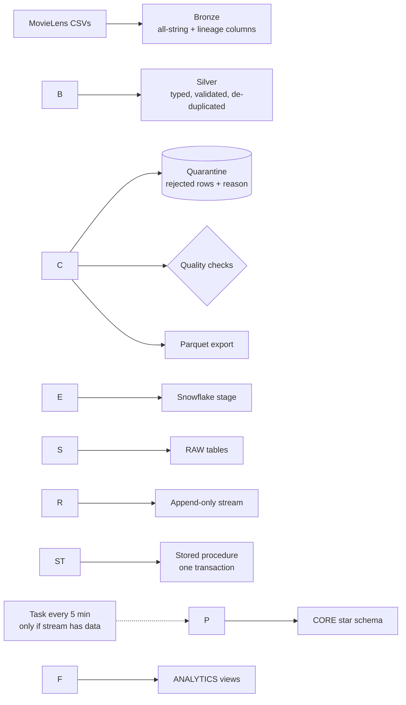

# MovieLens Lakehouse: PySpark/Databricks → Snowflake

An end-to-end ELT pipeline over the [MovieLens 25M](https://grouplens.org/datasets/movielens/25m/) dataset (25M ratings, \~62K movies).

* **Databricks / PySpark** ingests raw CSVs into a Bronze → Silver lakehouse: every value validated, bad rows quarantined with a reason instead of dropped.
* **Snowflake** loads the cleaned data into a star schema, keeps it current with a **Stream + Task + stored procedure** (transactional, safe to retry), and exposes analytics views built with CTEs and window functions.
* **Quality gates** run in both places, and **GitHub Actions** runs the Spark tests plus an end-to-end smoke run on every push.

## Architecture



## Repository layout

```
src/movielens\_pipeline/   bronze.py  silver.py  quality.py  run\_pipeline.py  storage.py  spark\_session.py
notebooks/                databricks\_pipeline.py   (Databricks notebook, same logic, writes Delta tables)
snowflake/                01\_setup  02\_raw\_tables  03\_load\_raw  04\_star\_schema
                          05\_incremental\_load  06\_data\_quality  07\_analytics
scripts/                  make\_sample\_data.py      (synthetic MovieLens-format data with injected defects)
tests/                    test\_silver.py  test\_quality.py  conftest.py
.github/workflows/        ci.yml
```

## Quick start (local, \~2 minutes, no downloads)

Requires Python 3.9+ and Java 17. On Windows use **WSL** or a GitHub Codespace (local Spark on native Windows needs extra Hadoop setup).

```bash
python -m venv .venv \&\& source .venv/bin/activate
pip install -r requirements.txt

python scripts/make\_sample\_data.py --out data/sample      # 500 movies, 101,000 ratings (1,000 deliberately bad)
pytest -q                                                 # unit tests for transforms and quality checks
PYTHONPATH=src python -m movielens\_pipeline.run\_pipeline \\
    --input-dir data/sample --output-dir output
```

The run writes `output/bronze`, `output/silver`, `output/export` (parquet for Snowflake) and `output/quality\_report.json`.

### What a correct run produces on the sample data

The generator injects a known number of each defect, so the result is checkable. These expected values were computed independently with plain Python, so if your report differs, something is wrong.

|Metric|Expected|
|-|-|
|Bronze ratings rows|101,000|
|Silver ratings rows|100,000|
|Silver movies rows|500|
|Silver movie\_genres rows|855|
|Quarantined: `duplicate\_superseded`|167|
|Quarantined: `rating\_out\_of\_range`|167|
|Quarantined: `null\_or\_invalid\_rating`|167|
|Quarantined: `unknown\_movie`|167|
|Quarantined: `rating\_not\_half\_step`|166|
|Quarantined: `timestamp\_out\_of\_range`|166|
|All quality checks|pass|

## Running on the real dataset

### 1\. Databricks (PySpark, Delta)

1. Create a [Databricks Free Edition](https://www.databricks.com/learn/free-edition) workspace and add this repo as a **Git folder**.
2. Download `ml-25m.zip` from [GroupLens](https://grouplens.org/datasets/movielens/25m/) and unzip it.
3. Open `notebooks/databricks\_pipeline.py`, run the first cell (creates the schema and a volume), then upload `ratings.csv` and `movies.csv` to the volume path it prints.
4. Run the remaining cells. Bronze and Silver are written as Delta tables, quality checks run, and Silver is exported as parquet to `<volume>/export/`.
5. Download the export folders from Catalog Explorer. Check the free tier's current limits before starting; they change.

### 2\. Snowflake

Run the scripts in order in a Snowsight worksheet (a 30-day free trial is enough):

|Script|Purpose|
|-|-|
|`01\_setup.sql`|warehouse (XSMALL, auto-suspend 60s), database, schemas, file format, stage|
|`02\_raw\_tables.sql`|RAW tables, ops tables, append-only **stream**|
|`03\_load\_raw.sql`|upload to stage (UI or SnowSQL `PUT`), `COPY INTO`, row-count check|
|`04\_star\_schema.sql`|star schema DDL, idempotent dimension loads|
|`05\_incremental\_load.sql`|**stored procedure**, initial fact load, scheduled **task**|
|`06\_data\_quality.sql`|`V\_DQ\_CHECKS` view: integrity checks and RAW-vs-fact reconciliation|
|`07\_analytics.sql`|seven analytics views (CTEs, window functions)|

After the last script, suspend the task: `ALTER TASK MOVIELENS.OPS.TASK\_LOAD\_FACT\_RATINGS SUSPEND;`

## Star schema

```mermaid
erDiagram
    FACT\_RATINGS }o--|| DIM\_USER : user\_key
    FACT\_RATINGS }o--|| DIM\_MOVIE : movie\_key
    FACT\_RATINGS }o--|| DIM\_DATE : date\_key
    DIM\_MOVIE ||--o{ BRIDGE\_MOVIE\_GENRE : movie\_key
    DIM\_GENRE ||--o{ BRIDGE\_MOVIE\_GENRE : genre\_key
```

Grain of `FACT\_RATINGS`: one row per (user, movie), holding the user's latest rating.

## Design decisions

* **Bronze keeps everything as strings.** The read can never fail on a malformed value, and the raw data stays available for reprocessing. All typing happens in Silver.
* **Quarantine instead of silent drops.** Each rejected row keeps its source, original record (JSON) and a machine-readable reason, so every input row is accounted for: `kept + quarantined = input`. A unit test enforces this.
* **Latest rating wins.** MovieLens allows a user to re-rate a movie; duplicates are collapsed deterministically (latest timestamp, then higher rating) and the superseded rows are quarantined, not lost.
* **One load path.** The stream is created before the first load, so the initial load and every later batch use the same stored procedure.
* **The procedure runs in one explicit transaction.** A stream's offset only advances when the reading transaction commits. If any step fails, everything rolls back and the batch remains in the stream to be retried, so no ratings are lost or half-loaded. Failures are logged to `OPS.PIPELINE\_LOG`.
* **Append-only stream.** A ratings feed only inserts, and append-only streams are cheaper than standard ones.
* **Surrogate keys + MERGE.** Dimension loads are idempotent and keep surrogate keys stable across re-runs. `DIM\_MOVIE` is SCD type 1 (changes overwrite).
* **Bridge table for genres.** Movies have several genres, so a bridge avoids duplicating fact rows. Consequence: rating counts summed across genres exceed the true total, which is noted in the SQL.
* **Weighted rating.** Raw averages favor movies with a handful of 5-star ratings, so rankings use a Bayesian average with a prior of 50 ratings.
* **TIMESTAMP\_MICROS parquet.** Spark's default INT96 timestamps are legacy; microsecond timestamps load cleanly into Snowflake.

## Data quality

|Layer|Checks|
|-|-|
|Silver (PySpark, `quality.py`)|min rows, no nulls in key columns, unique keys, rating range, referential integrity (ratings→movies, genres→movies), release-year null rate ≤ 5%|
|Snowflake (`06\_data\_quality.sql`)|unique fact grain, rating range, all foreign keys, every movie has a genre, RAW-vs-fact row reconciliation|

The Silver run exits non-zero if any check fails, which fails the notebook, job or CI step.

## Results on MovieLens 25M

\## Results on MovieLens 25M


| Metric | Value |

|---|---|

| Bronze ratings rows | 25,000,095 |

| Bronze movies rows | 62,423 |

| Silver ratings rows | 25,000,095 |

| Quarantined rows | 0 (the real dataset is clean; quarantine logic was verified on synthetic dirty data) |

| Movies without a release year | 0.66% |

| Snowflake RAW row counts | ratings 25,000,095 / movies 62,423 / genres 112,307 (match Silver) |

| Star schema | FACT\_RATINGS 25,000,095 rows; DIM\_MOVIE 62,423; DIM\_GENRE 20 |

| Warehouse data-quality checks | 8 of 8 pass |

| Incremental load demo | 5 new ratings flowed stream → stored procedure → fact table |

| `V\_TOP\_MOVIES\_BY\_GENRE` (Sci-Fi) | 1.7 s on an X-Small warehouse |Limitations

* The Databricks → Snowflake hand-off is a manual export/upload. A production setup would use the Snowflake Spark connector, cloud object storage with Snowpipe, or Delta Sharing.
* `DIM\_USER` only holds activity bounds because MovieLens has no user attributes.
* The Snowflake task polls every 5 minutes; it is a demonstration of incremental loading, not an orchestrator. Larger workflows would use Airflow or Databricks Workflows.
* No Power BI dashboard is included; the `ANALYTICS` views are designed to be connected to one.

## Data attribution

Dataset: F. Maxwell Harper and Joseph A. Konstan. 2015. *The MovieLens Datasets: History and Context.* ACM TiiS 5(4). MovieLens data is licensed for non-commercial research use and may not be redistributed, which is why `data/` is git-ignored and this repo ships a synthetic generator instead.

